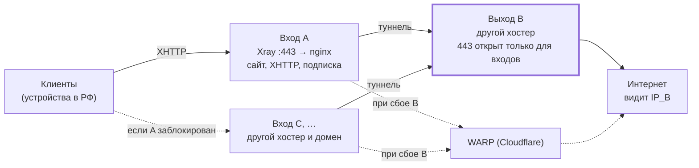

# CHOKEPOINT — информер о блокировках

## Оглавление

1. [О проекте](#1-о-проекте)
2. [Структура репозитория](#2-структура-репозитория)
3. [Требования](#3-требования)
4. [Быстрый старт](#4-быстрый-старт)
   - [Каталог установки](#каталог-установки)
   - [Миграция со старого пути](#миграция-со-старого-пути)
5. [Локальный запуск без домена](#5-локальный-запуск-без-домена)
6. [TLS-сертификаты и автопродление](#6-tls-сертификаты-и-автопродление)
   - [Как это устроено](#как-это-устроено)
   - [Включить, проверить, отключить](#включить-проверить-отключить)
   - [Ручной запуск](#ручной-запуск)
   - [Лог и срок действия](#лог-и-срок-действия)
   - [Вариант с systemd timer вместо cron](#вариант-с-systemd-timer-вместо-cron)
7. [Обновление контента](#7-обновление-контента)
   - [Новости](#новости)
   - [Как применить изменения](#как-применить-изменения)
   - [Тесты](#тесты)
8. [Режим «сайт-заглушка для REALITY» (3x-ui)](#8-режим-сайт-заглушка-для-reality-3x-ui)
   - [Как это устроено](#как-это-устроено-1)
   - [Требования](#требования)
   - [Включение](#включение)
   - [Что ввести в 3x-ui](#что-ввести-в-3x-ui)
     - [Инбаунд XHTTP: подробнее](#инбаунд-xhttp-подробнее)
     - [XMUX и `extra`](#xmux-и-extra)
   - [Переменные в `.env`](#переменные-в-env)
   - [Порядок при переходе между режимами](#порядок-при-переходе-между-режимами)
   - [Проверка](#проверка)
   - [Особенности](#особенности)
9. [Инфраструктура: вход и выход](#9-инфраструктура-вход-и-выход)
   - [Зачем](#зачем)
   - [Схема](#схема)
   - [Типы серверов](#типы-серверов)
   - [Сервер B: `setup-exit.sh`](#сервер-b-setup-exitsh)
   - [Настройка 3x-ui на входе](#настройка-3x-ui-на-входе)
   - [Ссылки и подписка](#ссылки-и-подписка)
   - [Клиенты](#клиенты)
   - [Замена заблокированного входа](#замена-заблокированного-входа)
   - [Сайт-заглушка для боевого сервера](#сайт-заглушка-для-боевого-сервера)
10. [Пасхалка](#10-пасхалка)
11. [Частые проблемы](#11-частые-проблемы)

## 1. О проекте

**CHOKEPOINT** — статический лендинг на русском языке о том, как в России устроена фильтрация интернет-трафика. В нём разделы:

- что такое DPI и чем он отличается от блокировки по IP и DNS;
- что такое ТСПУ: правовая основа, кто управляет системой, где стоит оборудование;
- известное из открытых источников оборудование и ПО — российское и мировое для сравнения;
- хронология ключевых событий;
- новости за последние 6 месяцев на момент сборки;
- полный список источников.

> **Дисклеймер.** Информация носит ознакомительный характер и собрана из открытых источников. Сайт не содержит инструкций и рекомендаций по обходу блокировок. Факты, подтверждённые только публикациями в прессе, помечены «по данным СМИ».

Сайт — чистая статика: HTML, CSS и vanilla JS на ES-модулях, без сборщиков. Всё нужное лежит локально, во время работы страница не обращается к внешним доменам. В Docker сайт раздаёт nginx с HTTPS от Let's Encrypt.

Актуально на **10.11.2026**.

Кроме самого сайта, в репозитории есть режим «сайт-заглушка для REALITY» в 3x-ui (раздел 8) и всё для схемы «вход ≠ выход»: скрипт выходного сервера и описание настройки (раздел 9, подробная инструкция — [docs/vpn-tspu-guide.md](docs/vpn-tspu-guide.md)). Для боевого входного сервера лендинг лучше заменить своим скучным сайтом, см. «Сайт-заглушка для боевого сервера» в разделе 9.

## 2. Структура репозитория

```text
.
├── site/                       # сайт (монтируется в nginx только для чтения)
│   ├── index.html              # главная страница, внутри разметка свитка-пасхалки
│   ├── 404.html                # страница 404 в стилистике сайта
│   ├── css/                    # fonts.css, main.css, scroll.css (свиток), 404.css
│   ├── js/                     # ES-модули: main, hero-canvas, reveal, news, scroll-modal, easter-egg-counter
│   ├── data/news.json          # новости — правятся без изменения вёрстки
│   ├── assets/                 # логотип и SVG-текстуры
│   └── fonts/                  # woff2 (Inter, JetBrains Mono, Yeseva One, Cormorant Garamond) + лицензии OFL
├── nginx/
│   ├── templates/              # боевой конфиг-шаблон (envsubst подставляет ${DOMAIN})
│   ├── local-templates/        # конфиг для локального режима https://localhost:8443
│   ├── reality-templates/      # конфиг режима «сайт-заглушка для REALITY» (раздел 8)
│   ├── conf.d/00-http.conf     # http-уровень: server_tokens, gzip, TLS-параметры, кэш
│   └── snippets/               # заголовки безопасности, раздача сайта, ACME и /healthz
├── scripts/
│   ├── init-letsencrypt.sh     # первичный выпуск сертификата (есть флаг --staging)
│   ├── renew-certs.sh          # продление и reload nginx (для cron)
│   ├── cron.sh                 # install / remove / status / run для расписания продления
│   ├── reality.sh              # enable / disable / status / panel для режима REALITY
│   ├── setup-exit.sh           # настройка выходного сервера B (раздел 9), запускается на B
│   ├── lib.sh                  # общие функции скриптов
│   └── selfsigned.py           # временный самоподписанный сертификат (запускается в контейнере certbot)
├── tests/
│   ├── easter-egg-counter.test.mjs  # тесты логики пасхалки (node, без зависимостей)
│   ├── scroll-text.test.mjs         # сверка текста свитка с эталоном
│   ├── nginx-templates.test.mjs     # рендер шаблонов nginx и проверка директив
│   ├── scripts.test.sh              # тесты cron.sh, renew-certs.sh и reality.sh на заглушках
│   ├── setup-exit.test.sh           # тесты setup-exit.sh: разбор xray x25519, конфиг, повторный запуск
│   └── fixtures/scroll-text.txt     # эталонный текст свитка
├── tools/
│   ├── build-scroll.mjs        # генерирует разметку свитка из эталонного текста
│   └── dev-server.mjs          # локальный просмотр без Docker (с той же CSP)
├── docs/vpn-tspu-guide.md      # пошаговая инструкция «вход ≠ выход» (раздел 9)
├── research/notes.md           # исследование: каждый факт с источником и датой
├── logs/                       # сюда пишется renew.log
├── docker-compose.yml          # боевой режим: web (nginx) + certbot (profile)
├── docker-compose.local.yml    # локальный режим с самоподписанным сертификатом
├── docker-compose.reality.yml  # надстройка для режима REALITY (подключает scripts/reality.sh)
└── .env.example                # DOMAIN и LETSENCRYPT_EMAIL
```

## 3. Требования

- Linux-сервер (VPS) с белым IP.
- **Docker** и **Docker Compose v2**, то есть команда `docker compose`, а не `docker-compose`. Для режима REALITY (раздел 8) нужна версия Compose не ниже 2.24.4.
- **Домен**, A-запись которого указывает на IP сервера. Если у сервера есть IPv6 и вы добавляете AAAA-запись, она должна вести на этот же сервер.
- Открытые входящие порты **80** и **443**. Порт 80 нужен Let's Encrypt для проверки домена.
- На хосте **`cron`** и **`flock`**. `flock` входит в пакет `util-linux` и в большинстве дистрибутивов уже установлен.

Проверка:

```bash
docker --version
docker compose version
command -v crontab flock
getent hosts example.org     # подставьте свой домен: должен вернуться IP сервера
```

## 4. Быстрый старт

```bash
sudo git clone <URL-репозитория> /opt/site
cd /opt/site
chmod +x scripts/*.sh

cp .env.example .env
nano .env        # укажите DOMAIN и LETSENCRYPT_EMAIL
```

Пробный выпуск на тестовом сервере Let's Encrypt. Он не упирается в лимиты, но браузеры такому сертификату не доверяют:

```bash
./scripts/init-letsencrypt.sh --staging
```

Если всё прошло успешно, выпустите настоящий сертификат. Скрипт сам заменит тестовый:

```bash
./scripts/init-letsencrypt.sh
```

Запуск, или проверка, что всё запущено:

```bash
docker compose up -d
docker compose ps          # у web должен быть статус healthy
```

Включите автопродление (подробнее в разделе 6):

```bash
./scripts/cron.sh install
```

Сайт доступен по адресу `https://ваш-домен/`.

> **Почему сначала `init-letsencrypt.sh`, а потом `up`.** Конфиг nginx ссылается на файлы сертификата. Без них nginx не стартует. Скрипт создаёт временный сертификат, поднимает nginx, получает настоящий сертификат и перезагружает nginx. После этого `docker compose up -d` только убеждается, что контейнер работает. Скрипт идемпотентен, повторный запуск ничего не сломает.

### Каталог установки

Рекомендуемый каталог — `/opt/site`. Название репозитория в путях на сервере не используйте: путь вида `~/dpi-selfsteal` сам подсказывает, что это за сервер. По той же причине у Docker-проекта, томов и задач нейтральные имена: проект `site`, тома `site_letsencrypt` и `site_certbot-webroot`, сервис `web`, метка cron `# site-renew`, лог `logs/renew.log`.

Скрипты сами находят каталог по своему расположению, поэтому работают из любого места. Чтобы указать каталог явно (например, при запуске из другого места или из своего юнита), задайте переменную `INSTALL_DIR` — она общая для всех скриптов:

```bash
INSTALL_DIR=/opt/site /opt/site/scripts/renew-certs.sh --dry-run
```

### Миграция со старого пути

Старые установки лежали в каталоге с названием репозитория (например, `~/dpi-selfsteal`), Docker-проект назывался `chokepoint`, а сертификат хранился в томе `chokepoint_letsencrypt`. Перенос без перевыпуска сертификата:

```bash
# 1. Остановить стек СТАРЫМ кодом, до git pull (тома при этом сохраняются; флаг -v не указывать)
cd ~/dpi-selfsteal
docker compose down

# 2. Перенести каталог и обновить код
sudo mv ~/dpi-selfsteal /opt/site
cd /opt/site
git pull

# 3. Скопировать сертификат в том нового проекта
docker volume create site_letsencrypt
docker run --rm -v chokepoint_letsencrypt:/from:ro -v site_letsencrypt:/to alpine cp -a /from/. /to/

# 4. Поднять и проверить
docker compose up -d
docker compose ps                        # web — healthy
./scripts/renew-certs.sh --dry-run       # продление работает

# 5. Расписание продления: install заменит старую запись (новый путь и метка, минута сохранится)
./scripts/cron.sh install
```

- Если `git pull` уже сделан и шаг 1 не останавливает контейнеры, остановите старый проект по имени: `docker compose -p chokepoint down`.
- В режиме REALITY настройки лежат в `.env` и переезжают вместе с каталогом. После шага 4 проверьте `./scripts/reality.sh status`.
- Если продление было на systemd, отключите старые юниты и создайте новые по разделу 6: `sudo systemctl disable --now chokepoint-renew.timer && sudo rm /etc/systemd/system/chokepoint-renew.{service,timer} && sudo systemctl daemon-reload`.
- Пока сертификат не перенесён, `init-letsencrypt.sh`, `renew-certs.sh` и `reality.sh` останавливаются с подсказкой, а не выпускают сертификат заново.
- Когда всё работает, старые тома можно удалить: `docker volume rm chokepoint_letsencrypt chokepoint_certbot-webroot`.

## 5. Локальный запуск без домена

Локальный режим поднимает тот же nginx с теми же заголовками на `https://localhost:8443`. Самоподписанный сертификат создаётся автоматически. Порт `8080` редиректит на HTTPS.

```bash
docker compose -f docker-compose.local.yml up -d
docker compose -f docker-compose.local.yml ps
```

Проверка:

```bash
curl -kI https://localhost:8443/                    # 200, CSP, HSTS, Cache-Control
curl -kI https://localhost:8443/data/news.json      # 200, короткий кэш
curl -kI https://localhost:8443/no-such-page        # 404, своя страница
curl -I  http://localhost:8080/                     # 301 → https://localhost:8443/
```

Браузер предупредит о самоподписанном сертификате, это ожидаемо. Остановка:

```bash
docker compose -f docker-compose.local.yml down
```

Чтобы посмотреть сайт совсем без Docker, нужен Node.js:

```bash
node tools/dev-server.mjs 8000      # http://localhost:8000
```

## 6. TLS-сертификаты и автопродление

### Как это устроено

Сертификаты Let's Encrypt действуют 90 дней. Команда `certbot renew` сама решает, пора ли продлевать: по умолчанию за 30 дней до истечения срока. В остальное время она ничего не делает, поэтому запускать её часто безопасно. Let's Encrypt рекомендует запуск дважды в сутки.

Почему расписание на хосте, а не в контейнере:

- Если ставить certbot пакетом прямо на систему, он сам добавляет systemd-таймер или задачу cron. В официальном Docker-образе `certbot/certbot` планировщика нет. Поэтому сервис `certbot` здесь одноразовый: он стоит под `profiles: ["certbot"]`, не стартует при `docker compose up` и запускается только скриптами.
- Флаг `--deploy-hook` в certbot выполняется внутри контейнера certbot. Перезагрузить оттуда nginx нельзя, он живёт в другом контейнере. Поэтому reload делает `scripts/renew-certs.sh` после `renew`, и только если отпечаток SHA-256 файла `fullchain.pem` изменился.

`renew-certs.sh` работает так:

- путь к проекту вычисляет от своего расположения;
- задаёт полный `PATH`, поэтому работает из cron;
- через `flock` не даёт двум запускам пересечься;
- пишет лог с датами в `logs/renew.log`;
- при ошибке возвращает ненулевой код.

### Включить, проверить, отключить

```bash
./scripts/cron.sh install    # запись вида: 17 3,15 * * * '/путь/scripts/renew-certs.sh' >/dev/null 2>&1 # site-renew
./scripts/cron.sh status     # запись и последние строки лога
crontab -l                   # убедиться напрямую
./scripts/cron.sh remove     # отключить
```

`install` выбирает случайную минуту и не создаёт дублей: повторный вызов только показывает существующую запись.

### Ручной запуск

```bash
./scripts/cron.sh run                  # то же, что делает cron
./scripts/renew-certs.sh --dry-run     # проверка цепочки на тестовом сервере LE, сертификат не меняется
./scripts/renew-certs.sh --force       # принудительное продление (--force-renewal)
```

> ⚠️ `--force` выпускает новый сертификат независимо от срока действия и расходует лимиты Let's Encrypt. Сейчас это 5 одинаковых сертификатов на один набор доменов за 7 дней. Для проверки используйте `--dry-run`.

### Лог и срок действия

```bash
tail -n 50 logs/renew.log
```

Узнать срок действия сертификата. Команда запускает openssl в отдельном одноразовом контейнере с томом сертификатов, доступным только для чтения:

```bash
. ./.env
docker run --rm -v site_letsencrypt:/etc/letsencrypt:ro alpine/openssl \
  x509 -enddate -noout -in "/etc/letsencrypt/live/$DOMAIN/fullchain.pem"
```

Ещё один вариант — встроенная команда certbot:

```bash
docker compose --profile certbot run --rm certbot certificates
```

Проверка «снаружи», того сертификата, который реально отдаёт nginx:

```bash
. ./.env
echo | openssl s_client -connect "$DOMAIN:443" -servername "$DOMAIN" 2>/dev/null | openssl x509 -noout -enddate
```

### Вариант с systemd timer вместо cron

Если вы предпочитаете systemd, не включайте cron (`./scripts/cron.sh remove`). Вместо него создайте два файла. `/opt/site` — каталог установки; если у вас другой, замените.

`/etc/systemd/system/site-renew.service`:

```ini
[Unit]
Description=Продление сертификата Let's Encrypt
Wants=network-online.target docker.service
After=network-online.target docker.service

[Service]
Type=oneshot
ExecStart=/opt/site/scripts/renew-certs.sh
# если проект принадлежит обычному пользователю из группы docker:
# User=deploy
```

`/etc/systemd/system/site-renew.timer`:

```ini
[Unit]
Description=Продление сертификата дважды в сутки

[Timer]
OnCalendar=*-*-* 03,15:00:00
RandomizedDelaySec=3600
Persistent=true

[Install]
WantedBy=timers.target
```

Включение и проверка:

```bash
sudo systemctl daemon-reload
sudo systemctl enable --now site-renew.timer
systemctl list-timers site-renew.timer
sudo systemctl start site-renew.service     # ручной запуск
journalctl -u site-renew.service -n 50
```

## 7. Обновление контента

### Новости

Новости хранятся в `site/data/news.json` и выводятся на странице через JS. Вёрстку трогать не нужно. Добавьте объект в массив `items`:

```json
{
  "id": "n13",
  "date": "2026-11-20",
  "title": "Короткий заголовок своими словами",
  "summary": "Одно-два предложения пересказа без длинных цитат.",
  "source": "Название издания",
  "url": "https://example.org/article",
  "tags": ["russia", "research"]
}
```

- `date` — дата публикации источника в формате `ГГГГ-ММ-ДД`. Карточки сортируются по ней, новые идут сверху.
- `id` — уникальный идентификатор. Под ним новость попадает в раздел «Источники» как «н13».
- `tags` — ключи из объекта `tags` в начале файла: `russia`, `world`, `research`, `courts`, `society`. По ним работают фильтры.
- Обновите поле `updated` и дату «Актуально на» в `site/index.html`: она указана в hero, в разделе новостей и в футере.

Проверить, что JSON корректен:

```bash
node -e "JSON.parse(require('fs').readFileSync('site/data/news.json','utf8')); console.log('ok')"
```

### Как применить изменения

Каталог `site/` смонтирован в контейнер напрямую, поэтому перезапуск не нужен. Достаточно обновить файлы на сервере:

```bash
git pull
```

HTML и `news.json` кэшируются на 5 минут. CSS, JS и изображения кэшируются на 30 дней, поэтому после правки стилей посетители увидят изменения не сразу. Чтобы изменения применились сразу, поменяйте имя файла или добавьте к ссылке параметр `?v=2`. Шрифты кэшируются на год.

Если вы меняли конфиг nginx:

```bash
docker compose exec web nginx -t && docker compose exec web nginx -s reload
```

Если меняли шаблон в `nginx/templates/`, контейнер нужно пересоздать, потому что envsubst выполняется при старте:

```bash
docker compose up -d --force-recreate web
```

### Тесты

```bash
node tests/easter-egg-counter.test.mjs
node tests/scroll-text.test.mjs
node tests/nginx-templates.test.mjs
bash tests/scripts.test.sh     # только на машине без настоящего crontab: тест подменяет crontab заглушкой
bash tests/setup-exit.test.sh  # setup-exit.sh на заглушках (xray, ufw, systemctl); нужен node
```

## 8. Режим «сайт-заглушка для REALITY» (3x-ui)

Сайт можно использовать как target-сервер для инбаунда VLESS + REALITY в [3x-ui](https://github.com/MHSanaei/3x-ui). В этом режиме на порту 443 работает Xray, а nginx уходит на loopback. Посетитель без ключа REALITY видит обычный сайт с настоящим сертификатом. Через тот же nginx проходят XHTTP и подписка 3x-ui.

Режим включается одной командой и так же выключается. Обычный режим из разделов 4–7 при этом не меняется.

### Как это устроено

```text
Интернет :443
   │
   ▼
Xray (3x-ui), инбаунд VLESS + TCP + REALITY (Vision), 0.0.0.0:443
   │  клиент с ключом REALITY → прокси
   │  все остальные (браузеры, сканеры, XHTTP-клиенты) → target
   ▼
nginx 127.0.0.1:9443 (сертификат Let's Encrypt, HTTP/2)   ← этот репозиторий
   ├── /                 → сайт-заглушка (и статические подписки /TOKEN/*.txt, раздел 9)
   ├── XHTTP_PATH        → Xray, инбаунд XHTTP, 127.0.0.1:2023 (grpc_pass)
   ├── SUB_PATH          → подписка 3x-ui, 127.0.0.1:2096
   └── SUB_JSON_PATH     → JSON-подписка 3x-ui, 127.0.0.1:2096

nginx 0.0.0.0:80 → ACME-челлендж Let's Encrypt и 301-редирект на https
```

Клиенты подключаются через XHTTP. TCP-Reality-инбаунд на 443 нужен как фронт: он передаёт в nginx всех без ключа. Его ссылку клиентам не раздают (раздел 9).

Что меняется по сравнению с обычным режимом (`docker-compose.reality.yml`):

- Контейнер `web` работает в сети хоста (`network_mode: host`). Так `127.0.0.1` внутри nginx — это loopback сервера, где слушают Xray и 3x-ui. Порт 443 nginx не занимает.
- Конфиг nginx собирается из `nginx/reality-templates/default.conf.template`. Блоки XHTTP и подписки в нём повторяют шаг 2 инструкции «Всё на 443»:
  - для XHTTP: `grpc_pass`, таймауты 1 ч, `client_max_body_size 0`, `grpc_buffer_size 16k`;
  - для подписки: `proxy_pass` с `Host $host`.
- Заголовки безопасности, кэш, страница 404, выпуск и продление сертификата работают так же, как в обычном режиме. Ставить nginx и certbot на хост, как в шаге 2 инструкции, **не нужно**. Если они уже стоят, остановите их, иначе займут порт 80.

Режим подключается через переменную `COMPOSE_FILE` в `.env`. Поэтому `docker compose up -d`, `init-letsencrypt.sh`, `renew-certs.sh` и cron сами работают в выбранном режиме.

### Требования

- Linux-хост: `network_mode: host` работает только на Linux.
- Docker Compose ≥ 2.24.4.
- 3x-ui, установленная на хост официальным скриптом `install.sh`. Если 3x-ui запущена в Docker в обычной сети, `127.0.0.1` из nginx до неё не достанет.
- Домен с A-записью на сервер, открытые порты 80 и 443.

### Включение

```bash
cp .env.example .env             # если ещё не сделано; укажите DOMAIN и LETSENCRYPT_EMAIL
./scripts/reality.sh enable      # записывает параметры в .env и пересоздаёт nginx
./scripts/init-letsencrypt.sh    # если сертификата ещё нет: нужен только порт 80
./scripts/cron.sh install        # автопродление, как в разделе 6
./scripts/reality.sh panel       # значения, которые нужно ввести в 3x-ui
```

`enable` при первом запуске придумывает случайные неочевидные пути XHTTP и подписки. Повторный вызов их не меняет: все параметры, не указанные явно, берутся из `.env`. Свои значения задаются флагами:

```bash
./scripts/reality.sh enable \
  --xhttp-path /media/7f3k9q/ \
  --sub-path /s9x/ --sub-json-path /s9xj/ \
  --target 127.0.0.1:9443
./scripts/reality.sh enable --no-xhttp    # вариант «только TCP» из инструкции; вернуть — --xhttp
./scripts/reality.sh enable --no-sub      # не проксировать подписку; вернуть — --sub
./scripts/reality.sh enable --no-apply    # только записать .env, nginx не трогать
./scripts/reality.sh status               # текущий режим и параметры
```

Выключенные пути (`--no-xhttp`, `--no-sub`) отвечают обычной страницей 404 сайта, как несуществующие. Поэтому не появляется ни 502, ни других отличий от обычного сайта.

### Что ввести в 3x-ui

`./scripts/reality.sh panel` печатает готовые значения для ваших пути и домена. Кратко:

| Где в 3x-ui | Поле | Значение |
| --- | --- | --- |
| Инбаунд `tcp-reality` | Protocol / Port | `vless` / `443`, Listen IP пусто |
|  | Transmission / Security | `TCP` (RAW), `Reality`, Xver `0` |
|  | uTLS | `firefox` |
|  | Dest / Target | `127.0.0.1:9443` (`REALITY_TARGET_LISTEN`) |
|  | SNI / Server Names | ваш `DOMAIN` |
|  | Sniffing | `http`, `tls`, `quic`, Route Only |
|  | Клиент | Flow `xtls-rprx-vision`, свой неочевидный subId |
| Инбаунд `xhttp` | Listen IP / Port | `127.0.0.1` / `2023` (`XHTTP_UPSTREAM`) |
|  | Transmission / Path | `XHTTP`, путь `XHTTP_PATH`, Host пусто, Mode `auto` |
|  | Padding Bytes | `100-1000` |
|  | XMUX | вкл.: Max Concurrency `16-32` **или** Max Connections `1`, см. [XMUX и `extra`](#xmux-и-extra) |
|  | Sniffing | `http`, `tls`, `quic`, Route Only |
|  | Security | `none`: TLS снимает nginx |
|  | External Proxy | блок `externalProxy` с `fingerprint` в JSON инбаунда, см. ниже |
|  | Клиент | не создавать: привязать TCP-клиента через «Linked Inbounds» |
| Настройки → Подписка | Listen IP / Порт | `127.0.0.1` / `2096` (`SUB_UPSTREAM`) |
|  | URI Path | `SUB_PATH` |
|  | Reverse Proxy URI | `https://DOMAIN` + `SUB_PATH` (для JSON — `SUB_JSON_PATH`) |
|  | Сертификат и ключ | пусто |

Подписку через сервис 3x-ui можно оставить, но рекомендуемый вариант — статический файл в каталоге сайта (раздел 9, «Ссылки и подписка»).

#### Инбаунд XHTTP: подробнее

**Почему Security `none`, а в ссылке `security=tls`.** У XHTTP два участка:

```text
клиент ──TLS (сертификат DOMAIN, h2)──► nginx 127.0.0.1:9443 ──без TLS (h2c)──► Xray 127.0.0.1:2023
        ↑ это описывает ссылка:                                ↑ это описывает инбаунд:
          security=tls, sni, alpn, fp                            Security = none
```

TLS расшифровывает nginx, а до Xray доходит открытый HTTP/2. Если включить в инбаунде Security = TLS, Xray будет ждать от nginx TLS, которого нет, и ничего не заработает.

**External Proxy.** Чтобы панель подставляла в ссылку и подписку `DOMAIN:443`, `security=tls` и отпечаток вместо `127.0.0.1:2023`, в инбаунде нужен блок `externalProxy`. В интерфейсе 3x-ui v3 отдельного поля для него может не быть, поэтому добавьте его в JSON инбаунда, внутрь `"streamSettings": { ... }`. `reality.sh panel` печатает этот блок с вашим доменом:

```json
"externalProxy": [
  { "forceTls": "tls", "dest": "example.org", "port": 443, "remark": "", "sni": "example.org", "fingerprint": "firefox" }
]
```

- `dest` — **домен**, а не IP: тогда при замене сервера (раздел 9) достаточно сменить A-запись.
- `fingerprint` — отпечаток uTLS. По исходникам MHSanaei/3x-ui (генерация ссылок `internal/sub`, ранее `sub/subService.go`; схема `externalProxy` во фронтенде) панель превращает его в `fp=firefox` в ссылках и подписке **начиная с версии 3.2.0**, и только когда `forceTls` даёт `tls`. Более старые версии поле сохраняют, но в ссылку не выводят.
- В 3x-ui 3.4.0 и новее появилась страница **Хосты** (Hosts) с теми же полями: адрес, порт, SNI, Fingerprint, ALPN. Блок `externalProxy` в форме инбаунда там больше не редактируется (только через JSON), но продолжает работать. Если для инбаунда заведён хост, панель строит ссылки по нему, а не по `externalProxy`.

Сохраните и откройте инбаунд снова: блок должен остаться. В ссылке клиента («Инфо» / QR) должно быть `@example.org:443`, `security=tls` и `fp=firefox`.

**Клиент.** В 3x-ui v3 клиент — одна запись с одним subId, и её можно привязать к нескольким инбаундам. Второго клиента с тем же subId панель не создаст (`Duplicate subId`). Поэтому:

1. Откройте TCP-клиента на редактирование.
2. В «Linked Inbounds» добавьте инбаунд `xhttp` и сохраните.
3. Flow оставьте `xtls-rprx-vision`: в актуальных версиях 3x-ui Flow хранится для каждого инбаунда отдельно, и для XHTTP панель его убирает сама.
4. Проверьте XHTTP-ссылку: в ней не должно быть `flow=`. Если `flow=xtls-rprx-vision` есть, XHTTP работать не будет. Обновите панель (`x-ui update`) или включите у инбаунда `xhttp` опцию DisableFlow, если она есть в вашей версии.

**Ссылка вручную (запасной вариант).** Если `externalProxy` не сохраняется или ссылка всё равно с `127.0.0.1:2023`, соберите ссылку сами и добавьте её в клиент отдельно от подписки. Строку XHTTP с `127.0.0.1:2023` из подписки не используйте, TCP-строка в ней правильная. `reality.sh panel` печатает шаблон с вашими доменом и путём:

```text
vless://UUID@example.org:443?type=xhttp&path=%2Fmedia%2F0123456789%2F&mode=auto&security=tls&sni=example.org&alpn=h2&fp=firefox#xhttp
```

Если в сгенерированной панелью ссылке нет `fp=`, сначала проверьте поле `fingerprint` в `externalProxy` и версию панели (нужна 3.2.0+). Запасной вариант — дописать `&fp=firefox` к ссылке вручную или выбрать отпечаток firefox в профиле клиента. Отпечаток везде один — `firefox`: в ссылках, в Reality-инбаунде и в исходящем `exit` из `setup-exit.sh`.

#### XMUX и `extra`

XMUX задаётся в самом XHTTP-инбаунде: **Подключения → инбаунд `xhttp` → Редактировать → блок транспорта XHTTP → переключатель XMUX**. После включения появляются поля Max Concurrency, Max Connections, Max Reuse Times, Max Request Times, Max Reusable Secs и Keep Alive Period. Там же, выше, — Padding Bytes.

| Поле | Значение |
| --- | --- |
| Max Concurrency (`maxConcurrency`) | `16-32` — по умолчанию, быстрее |
| Max Connections (`maxConnections`) | пусто; `1` — если VPN пропадает на 1–10 минут из-за лимита TLS-рукопожатий; `2-4` — компромисс для мобильного интернета |
| Max Reuse Times (`cMaxReuseTimes`) | `64-128`, не `0` |
| Max Request Times (`hMaxRequestTimes`) | `600-900` |
| Max Reusable Secs (`hMaxReusableSecs`) | `1800-3000` |
| Padding Bytes (`xPaddingBytes`) | `100-1000` |

Везде диапазоны, а не фиксированные числа: так размеры и интервалы меняются от соединения к соединению.

**Max Concurrency и Max Connections взаимоисключающие**: заполняется одно, второе пустое. Форма панели сама очищает второе поле, но сохраняет его как `0` или пустую строку. После сохранения откройте JSON инбаунда и, если в блоке `xmux` есть `"maxConcurrency": ""` или `"maxConnections": ""`, удалите этот ключ: пустая строка вместо отсутствующего ключа может ломать разбор на клиенте.

**Попадает ли это в ссылку.** По исходникам 3x-ui начиная с версии 3.2.0 панель кладёт настройки XHTTP-инбаунда, включая блок `xmux` и `xPaddingBytes`, в параметр `extra` ссылки `vless://` и подписки (плюс отдельный `x_padding_bytes` для клиентов семейства sing-box). Проверьте ссылку клиента: в ней должен быть `extra=` с `xmux`. В более старых версиях панели XMUX работает только после ручного добавления на клиенте (поле Extra в v2rayN) — лучше обновите панель (`x-ui update`).

Остальные шаги инструкции выполняются в 3x-ui и на хосте, как в ней описано:
- SSH-туннель к панели;
- Listen IP панели `127.0.0.1`;
- `ufw` с портами SSH, 80 и 443;
- fail2ban.

Порт `9443` слушает только `127.0.0.1`, поэтому открывать его в файрволе не нужно. Контейнер в сети хоста не обходит `ufw`, в отличие от проброшенных через `-p` портов.

### Переменные в `.env`

`enable` записывает их сам, но их можно править и руками, после правки выполните `./scripts/reality.sh enable`:

| Переменная | По умолчанию | Назначение |
| --- | --- | --- |
| `COMPOSE_FILE` | `docker-compose.yml:docker-compose.reality.yml` | включает режим; `disable` удаляет строку |
| `REALITY_TARGET_LISTEN` | `127.0.0.1:9443` | где nginx ждёт трафик от REALITY (Dest/Target) |
| `XHTTP_ENABLED` | `on` | `off` — вариант «только TCP» |
| `XHTTP_PATH` | `/media/<случайно>/` | путь XHTTP, с `/` в начале и в конце |
| `XHTTP_UPSTREAM` | `127.0.0.1:2023` | XHTTP-инбаунд Xray |
| `SUB_ENABLED` | `on` | `off` — не проксировать подписку |
| `SUB_PATH`, `SUB_JSON_PATH` | `/<случайно>/` | пути подписки и JSON-подписки |
| `SUB_UPSTREAM` | `127.0.0.1:2096` | сервер подписок 3x-ui |

Пути не могут пересекаться с файлами сайта (`/assets/`, `/css/`, `/js/`, `/fonts/`, `/data/`) и друг с другом, это проверяет скрипт.

### Порядок при переходе между режимами

- **Обычный режим → REALITY.** Сначала `./scripts/reality.sh enable`: nginx освобождает 443. Потом создайте или включите в 3x-ui инбаунд на 443.
- **REALITY → обычный режим.** Сначала выключите инбаунд Xray на 443, потом `./scripts/reality.sh disable`: nginx снова займёт 80 и 443. Параметры REALITY останутся в `.env` для повторного включения.

### Проверка

```bash
. ./.env
# на сервере: target отвечает сайтом с настоящим сертификатом и HTTP/2
curl -sI --resolve "$DOMAIN:9443:127.0.0.1" "https://$DOMAIN:9443/" | head -n 1
# снаружи: через Xray открывается тот же сайт
curl -sI "https://$DOMAIN/" | head -n 1
# конфиг nginx внутри контейнера: XHTTP и подписка на месте
docker compose exec web nginx -T 2>/dev/null | grep -E 'listen|location|grpc_pass|proxy_pass'
# подписка (подставьте subId клиента)
curl -s "https://$DOMAIN${SUB_PATH}<subId>" | base64 -d | head
# наружу открыты только SSH, 80 и 443
ss -tlnp
```

### Особенности

- **ALPN и HTTP/2.** На target-сервере (`listen ${REALITY_TARGET_LISTEN} ssl` в `nginx/reality-templates/default.conf.template`) включён `http2 on;`, а `grpc_pass` для XHTTP работает только поверх HTTP/2. Поэтому `alpn=h2` в ссылке оставляем: клиент сразу договаривается с nginx на HTTP/2. Выбор зависит от одной строки `http2 on;`: если её убрать, XHTTP через этот nginx перестанет работать совсем, и тогда пришлось бы менять схему, а не только ссылку.
- **IP клиентов.** nginx видит все соединения с `127.0.0.1`, потому что их приводит Xray. Лимиты по IP в 3x-ui работают на TCP-инбаунде, для XHTTP — нет.
- **Сертификат.** Продление идёт через порт 80, Xray в этом не участвует. Отключать инбаунд на 443 на время выпуска сертификата не нужно, в отличие от шага 2 инструкции.

## 9. Инфраструктура: вход и выход

Это обзор. Пошаговая инструкция со всеми проверками — в [docs/vpn-tspu-guide.md](docs/vpn-tspu-guide.md), ниже даны ссылки на её шаги.

### Зачем

Клиенты подключаются к серверу типа **A (вход)**, а в интернет их трафик уходит с сервера типа **B (выход)** у другого хостера. Сайты и приложения видят только IP B, адрес A нигде не раскрывается. Если B заблокируют в России, на работу это не повлияет: участок A→B проходит между зарубежными серверами. Если B упадёт, трафик идёт через Cloudflare WARP. Напрямую с адреса A в интернет не уходит ничего.

### Схема



То же текстом:

```text
Основной путь:   Клиент --XHTTP--> Вход A --туннель--> Выход B --> Интернет (видит IP_B)
Ещё входы:       Клиент --XHTTP--> Вход C, D, … --туннель--> тот же выход B
Сбой выхода B:   Клиент --XHTTP--> Вход A --> WARP (Cloudflare) --> Интернет
Никогда:         Вход A --> Интернет напрямую
```

Входов может быть несколько, выход у них общий. Сплошные стрелки — обычный путь, пунктир — резервный.

### Типы серверов

| | Вход (A, C, …) | Выход (B) |
| --- | --- | --- |
| Что стоит | этот репозиторий (nginx в Docker, режим REALITY из раздела 8) и 3x-ui | только Xray, без панели (`scripts/setup-exit.sh`) |
| Открытые порты | SSH, 80 (Let's Encrypt), 443 | SSH; 443 — только с IP входов |
| Процессор и память | 2 vCPU, 2 ГБ | 1–2 vCPU, 1 ГБ |
| Порт | 1 Гбит/с | 1 Гбит/с |
| Трафик | от 5 ТБ в месяц | от 5 ТБ в месяц |
| Система | Linux с Docker | Ubuntu 22.04 или 24.04 |

Через каждый сервер трафик проходит дважды: на вход A он приходит от клиента и уходит на B, а B получает его от A и отправляет в интернет. Если хостер считает оба направления, 1 ТБ трафика клиентов расходует около 2 ТБ лимита на каждом сервере.

Рекомендации:

- 20–30 устройств на один вход;
- A и B в одном регионе, задержка между ними до 5–10 мс (проверка на A: `ping IP_B`);
- A и B — у разных хостеров.

### Сервер B: `setup-exit.sh`

Скрипт выполняет шаг 2 инструкции целиком: ставит `ufw`, `curl`, `openssl` и Xray (официальным скриптом XTLS/Xray-install), генерирует UUID туннеля, ключи x25519 и shortId, пишет `/usr/local/etc/xray/config.json` (VLESS + Reality + Vision на 443), проверяет конфиг, запускает Xray и закрывает 443 для всех, кроме входов. Работает на Ubuntu 22.04/24.04 от root. Репозиторий на B не нужен, достаточно одного файла:

```bash
# на входе A: скопировать скрипт на B
scp /opt/site/scripts/setup-exit.sh root@IP_B:

# на B
bash setup-exit.sh --entry IP_A
```

| Команда или опция | Что делает |
| --- | --- |
| `--entry IP` | IP входа, которому разрешён 443; можно указать несколько раз |
| `--ssh-port N` | SSH-порт B (по умолчанию берётся из настроек sshd) |
| `--sni домен` | маскировочный домен для Reality, по умолчанию `www.cloudflare.com` |
| `--address IP` | внешний IP B для вывода (по умолчанию определяется сам) |
| `--harden-ssh` | вход по SSH только по ключу; если в `authorized_keys` нет ни одного ключа, скрипт откажется |
| `--regenerate` | новые UUID и ключи; после этого обновите исходящее `exit` на всех входах |
| `add-entry IP` | разрешить ещё один вход (сервер C или замена A) |
| `remove-entry IP` | убрать вход из файрвола |
| `show` | снова показать данные для 3x-ui |

Что выведет скрипт:

- готовый JSON исходящего `exit` для вкладки «Исходящие» в 3x-ui на входе: адрес B, UUID, `publicKey`, `shortId`, `serverName`, `fingerprint: firefox`, `flow: xtls-rprx-vision`;
- те же значения таблицей, если в панели нет вкладки JSON и нужно заполнить форму;
- список разрешённых входов.

Значения сохраняются в `/root/exit-credentials.txt` (права `600`). Повторный запуск ничего не ломает: ключи берутся из этого файла и без `--regenerate` не меняются, новые `--entry` добавляются к сохранённым.

Проверка на входе A: `nc -vz -w 5 IP_B 443` должна ответить `succeeded`. С любого другого адреса соединение должно зависать.

### Настройка 3x-ui на входе

Шаги 3–5 инструкции. Перед началом сохраните копию базы: `cp /etc/x-ui/x-ui.db ~/x-ui.db.bak-$(date +%F)`.

1. **Sniffing.** В каждом входящем подключении (Reality и XHTTP): Sniffing включён, отмечены `http`, `tls`, `quic`, включён **Route Only**.
2. **WARP.** «Настройки Xray → Исходящие → WARP → Создать → Добавить исходящее». Тег должен быть `warp`. Сохранить и перезапустить Xray.
3. **Исходящее `exit`.** Добавляется **только на вкладке «Исходящие»** («Добавить исходящее» → вкладка JSON → вставить вывод `setup-exit.sh`, либо заполнить форму по таблице из вывода). **Не вставляйте его в расширенный шаблон:** новые версии 3x-ui при сохранении перезаписывают `outbounds` в шаблоне списком с вкладки «Исходящие», и вставленный блок пропадёт.
4. **Расширенный шаблон** («Настройки Xray → Расширенный шаблон»). Сначала скопируйте весь текст в файл-резервную копию. Меняется только `routing`, и добавляются `observatory` и `dns`. Раздел `outbounds` и остальные не трогайте. Замените `"routing": { … }` целиком и добавьте после него (если `dns` или `observatory` уже есть, старые удалите):

   ```json
   "routing": {
     "domainStrategy": "AsIs",
     "balancers": [
       { "tag": "out", "selector": [ "exit" ], "strategy": { "type": "leastPing" }, "fallbackTag": "warp" }
     ],
     "rules": [
       { "type": "field", "inboundTag": [ "api" ], "outboundTag": "api" },
       { "type": "field", "ip": [ "geoip:private" ], "outboundTag": "blocked" },
       { "type": "field", "ip": [ "::/0" ], "outboundTag": "blocked" },
       { "type": "field", "protocol": [ "bittorrent" ], "outboundTag": "blocked" },
       { "type": "field", "network": "tcp,udp", "balancerTag": "out" }
     ]
   },
   "observatory": {
     "subjectSelector": [ "exit" ],
     "probeUrl": "https://www.gstatic.com/generate_204",
     "probeInterval": "30s",
     "enableConcurrency": true
   },
   "dns": {
     "tag": "dns-internal",
     "servers": [ "https://1.1.1.1/dns-query", "https://8.8.8.8/dns-query" ],
     "queryStrategy": "UseIPv4"
   },
   ```

   > ⚠️ `fallbackTag` никогда не должен вести в `direct`: тогда при сбое B трафик пойдёт в интернет с адреса A, и вся схема теряет смысл. Только `warp`. По той же причине ни одно правило не должно вести в `direct`.

5. **XHTTP-инбаунд:** Mode `auto`, Padding Bytes `100-1000`, XMUX по таблице из раздела 8. Path должен совпадать с `location` в nginx, то есть с `XHTTP_PATH` из `.env` (`./scripts/reality.sh panel`).
6. **`externalProxy` с отпечатком** — блок в JSON XHTTP-инбаунда, с ним панель подставляет в ссылки домен, `security=tls`, `sni` и `fp=firefox`. Пример и версии 3x-ui — в разделе 8, «Инбаунд XHTTP: подробнее».

**Проверка.**

- В расширенном шаблоне в `outbounds` четыре блока: `exit`, `direct`, `blocked`, `warp`.
- С клиента через VPN [ifconfig.me](https://ifconfig.me) показывает **IP B**.
- Остановите Xray на B (`systemctl stop xray`) и подождите минуту: ifconfig.me показывает адрес Cloudflare. **Никогда не IP A.** Затем `systemctl start xray`.
- На A исходящие соединения Xray идут только на `IP_B:443` и `127.0.0.1`: `ss -tnp state established | grep xray`.

### Ссылки и подписка

Шаги 5.2 и 7 инструкции.

**Ссылка XHTTP**, которую панель показывает у клиента: после `@` стоит **домен**, есть `security=tls`, `sni=домен`, `fp=firefox` (берётся из `externalProxy`), `alpn=h2` и `extra=` с настройками XHTTP. `extra` и XMUX задаются в настройках XHTTP-инбаунда в 3x-ui (раздел 8), отдельно править ссылки не нужно.

**Подписка — рекомендуемый вариант: статический файл** в каталоге сайта. Каталог со случайным именем, по файлу на человека:

```bash
TOKEN=$(openssl rand -hex 16)
echo "Секретный каталог: $TOKEN"        # запишите
mkdir -p /opt/site/site/$TOKEN
nano /opt/site/site/$TOKEN/mama.txt
```

```text
#profile-title: Home
#profile-update-interval: 12
#socks-auth-mode: auto
#http-auth-mode: auto
vless://...XHTTP-ссылка этого человека...
```

- Адрес подписки: `https://example.org/TOKEN/mama.txt`. nginx отдаёт файл как обычную статику, перезапуск не нужен.
- `#socks-auth-mode: auto` и `#http-auth-mode: auto` заставляют Happ поставить пароль на локальный SOCKS/HTTP-прокси на телефоне, и другие приложения не смогут через него узнать про VPN.
- У каждого человека свой клиент (свой UUID) в 3x-ui: при утечке видно, чей ключ светится.
- **TCP-Reality-ссылку в подписку не включайте.** Reality-инбаунд остаётся на сервере как фронт на 443 и передаёт посторонние соединения в nginx, но клиенты подключаются через XHTTP.
- Каталоги вида `site/<32 hex>/` занесены в `.gitignore`, `git pull` их не тронет.

**Подписка через сервис 3x-ui** (`SUB_PATH` в разделе 8) продолжает работать. Директивы Happ к ней тоже применимы: заголовок, интервал обновления и пароль на локальный прокси задаются в настройках подписки панели (пароль на локальный прокси — начиная с 3x-ui 3.9.0, панель отдаёт его заголовками `Socks-Auth-Mode` и `Http-Auth-Mode`). Reality-инбаунд из такой подписки нужно исключить. Если ваша версия панели этого не умеет, используйте статический файл.

### Клиенты

- Весь трафик устройства идёт в VPN: режим «Глобально», без раздельной маршрутизации по доменам и без приложений-исключений.
- На компьютерах — режим **TUN**, а не системный прокси.
- Если большие страницы зависают, уменьшите MTU в настройках TUN до `1400`, а если не поможет, до `1380`.

Подробности для Happ и v2rayN — шаг 9 инструкции.

### Замена заблокированного входа

Шаг 11.1 инструкции. Ссылки и подписка указывают на домен, поэтому клиентов перенастраивать не нужно:

1. Новый VPS у другого хостера (или в другой подсети), файрвол: SSH, 80, 443.
2. Docker и 3x-ui, затем `systemctl stop x-ui`.
3. Перенести со старого входа `/etc/x-ui/x-ui.db` и каталог `/opt/site` (вместе с `.env` и подписками). Сертификат лежит не в каталоге, а в Docker-томе `site_letsencrypt`, его переносят отдельно (команды на новом сервере):

   ```bash
   scp -P SSH_PORT root@IP_A:/etc/x-ui/x-ui.db /etc/x-ui/x-ui.db
   rsync -a -e "ssh -p SSH_PORT" root@IP_A:/opt/site/ /opt/site/
   docker volume create site_letsencrypt
   ssh -p SSH_PORT root@IP_A 'docker run --rm -v site_letsencrypt:/v:ro alpine tar -C /v -czf - .'      | docker run --rm -i -v site_letsencrypt:/v alpine tar -C /v -xzf -
   systemctl start x-ui
   cd /opt/site && docker compose up -d
   ```

   Если том перенести не удалось, после смены DNS (шаг 5) выпустите сертификат заново: `./scripts/init-letsencrypt.sh`.
4. На B: `bash setup-exit.sh add-entry NEW_IP`.
5. В DNS сменить A-запись домена на `NEW_IP`. TTL заранее поставьте 300 секунд.
6. `./scripts/cron.sh install` на новом сервере, затем на B `bash setup-exit.sh remove-entry СТАРЫЙ_IP`.

### Сайт-заглушка для боевого сервера

Шаг 6 инструкции. Лендинг CHOKEPOINT из этого репозитория рассказывает о DPI и блокировках и одинаков у всех, кто развернул репозиторий. Для боевого входа его лучше заменить:

- скучный уникальный сайт на бытовую тему (портфолио, блог, визитка мастерской), 3–5 страниц, без слов VPN, proxy, DPI, ТСПУ и без ссылок на этот репозиторий;
- свои `404.html`, `favicon.ico`, `robots.txt`;
- `server_tokens off` и `error_page 404 /404.html` в конфиге nginx уже есть.

Файлы сайта кладутся в `/opt/site/site/`, перезапуск nginx не нужен.

## 10. Пасхалка

На сайте есть пасхалка.

## 11. Частые проблемы

**Закрыт 80-й порт.** Let's Encrypt проверяет домен по HTTP на порту 80. Откройте его в файрволе сервера и в настройках облака: security group, firewall панели хостинга.

```bash
sudo ufw allow 80/tcp && sudo ufw allow 443/tcp     # если используется ufw
curl -I http://ваш-домен/.well-known/acme-challenge/test   # снаружи должен быть ответ 404 от nginx, а не таймаут
```

**DNS ещё не обновился.** Изменения A-записи расходятся до нескольких часов. Проверьте, что домен указывает на ваш сервер, и только потом запускайте выпуск:

```bash
getent hosts ваш-домен
dig +short ваш-домен @1.1.1.1
curl -s https://ifconfig.me    # IP сервера — должен совпадать
```

**Упёрлись в лимиты Let's Encrypt** (ошибка `too many certificates` или `too many failed authorizations`). Дождитесь окончания окна: обычно это неделя для повторных сертификатов и час для неудачных проверок. Пока ждёте, отлаживайтесь с `--staging` и `--dry-run`. Не запускайте `--force` без необходимости.

**cron не видит `docker`.** У cron минимальный `PATH`. Скрипты сами добавляют `/usr/local/sbin:/usr/local/bin:/usr/sbin:/usr/bin:/sbin:/bin`. Если docker установлен в другое место, например через snap в `/snap/bin`, допишите путь в начало `scripts/lib.sh`. Пользователь, от имени которого стоит задача cron, должен иметь доступ к Docker: состоять в группе `docker` или быть root. Посмотрите `logs/renew.log`, ошибки вида «не найдена команда docker» попадают туда.

**nginx не стартует без сертификата** (в `docker compose logs web` видно `cannot load certificate`). Так бывает, если запустить `docker compose up -d` раньше `init-letsencrypt.sh` или если том с сертификатами удалили. Выполните:

```bash
./scripts/init-letsencrypt.sh
```

Если выпуск сертификата не удался, скрипт сам вернёт временный самоподписанный сертификат, чтобы nginx мог работать.

**Предупреждение `ssl_stapling ignored` в логах nginx.** Это нормально. В 2025 году Let's Encrypt прекратил поддержку OCSP, и в новых сертификатах нет OCSP-адреса. OCSP stapling в конфиге включён, но для сертификатов Let's Encrypt не используется.

**HSTS на localhost.** Локальный режим тоже отдаёт `Strict-Transport-Security`, чтобы его можно было проверить через `curl`. Некоторые браузеры запоминают HSTS и для `localhost`. Если потом http-сайты на localhost перестанут открываться, очистите HSTS для localhost в настройках браузера: в Chrome это `chrome://net-internals/#hsts`.

**Режим REALITY: nginx не стартует, `bind() to 0.0.0.0:80 failed (98: Address already in use)`.** Порт 80 на хосте занят: системным nginx из инструкции или Apache. Остановите их, например `sudo systemctl disable --now nginx`, и выполните `./scripts/reality.sh enable`.

**Режим REALITY: сайт по https не открывается, а на сервере `curl --resolve …:9443` работает.** Проверьте в инбаунде REALITY поле Dest/Target: должно быть `127.0.0.1:9443`, как в `REALITY_TARGET_LISTEN`. Проверьте и SNI/Server Names: должен быть ваш домен. Убедитесь, что инбаунд включён и слушает 443: `ss -tlnp | grep :443`.

**Режим REALITY: `docker compose` ругается на `!reset`.** Обновите Docker Compose до 2.24.4 или новее.

**Режим REALITY: XHTTP не подключается, в логе nginx 502.** Инбаунд XHTTP не запущен, либо его порт или путь не совпадает с `XHTTP_UPSTREAM` и `XHTTP_PATH`. Сверьте с `./scripts/reality.sh panel`, включая слеши.

**Режим REALITY: в XHTTP-ссылке адрес `127.0.0.1:2023`.** В инбаунде `xhttp` нет блока `externalProxy`. Добавьте его в JSON инбаунда (см. «Инбаунд XHTTP: подробнее») или соберите ссылку вручную.

**Режим REALITY: XHTTP не подключается, в логе Xray ошибка про flow.** В XHTTP-ссылке или конфиге остался `flow=xtls-rprx-vision`. Обновите панель (`x-ui update`) или включите у инбаунда `xhttp` опцию DisableFlow, если она есть.

**После обновления скрипты пишут про том `chokepoint_letsencrypt`.** Docker-проект переименован в `site`, и сертификат старой установки остался в томе со старым именем. Перенесите его по разделу «Миграция со старого пути» (шаг 3), выпускать заново не нужно.

**XHTTP перестал подключаться после настройки XMUX.** Проверьте JSON инбаунда: заполнено должно быть только одно из полей `maxConcurrency` и `maxConnections`, пустую строку `""` у второго удалите. Сверьте `xPaddingBytes` и `mode` в инбаунде и в ссылке клиента (параметр `extra`).

**Через VPN ifconfig.me показывает IP входа.** Не применились правила из раздела 9: последнее правило должно вести в `balancerTag: out`, исходящее `exit` должно быть на вкладке «Исходящие», а `fallbackTag` — `warp`, не `direct`.

**Режим REALITY: в подписке меньше серверов, чем ожидалось.** Инбаунд `xhttp` не привязан к клиенту через «Linked Inbounds» или выключен. Привяжите его и проверьте переключатели инбаундов.
