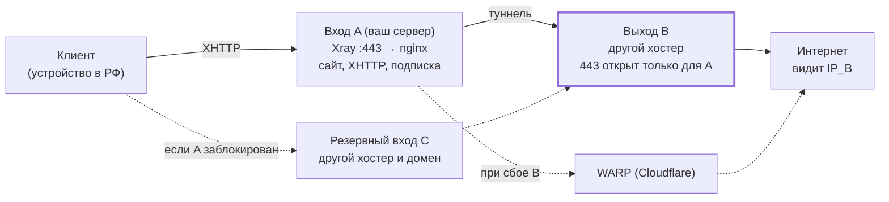

# Усиление VPN (Xray/VLESS) против ТСПУ: пошаговая инструкция

12 ноября 2026

## Что получится в итоге

Главное изменение: клиенты подключаются к вашему текущему серверу (**вход, сервер A**), а в интернет трафик уходит с другого сервера (**выход, сервер B**) у другого хостера. Любой сайт или приложение, которое проверяет «какой у меня IP», увидит адрес B. Адрес A, к которому подключаются клиенты, больше нигде не светится. Если B недоступен, трафик идёт через Cloudflare WARP, а если и он недоступен, соединение просто обрывается. Напрямую с адреса A трафик не уходит никогда.



Если схема выше не отрисовалась, вот то же самое текстом:

```
Основной путь:   Клиент --XHTTP--> Вход A --туннель--> Выход B --> Интернет (видит IP_B)
Сбой выхода B:   Клиент --XHTTP--> Вход A --> WARP (Cloudflare) --> Интернет
Блокировка A:    Клиент --XHTTP--> Резервный вход C --> Выход B --> Интернет
Никогда:         Вход A --> Интернет напрямую
```

Сплошные стрелки показывают обычный путь трафика, пунктир — резервные пути. Сервер C добавляется в шаге 11, WARP в шаге 3.

**Что понадобится купить**

| Что | Зачем | Обязательно? |
| --- | --- | --- |
| VPS у **другого** хостера (1 ядро, 1 ГБ ОЗУ, Ubuntu 22.04/24.04) | Сервер B, выход в интернет | Да |
| Ещё один VPS у третьего хостера + поддомен | Резервный вход (шаг 11) | Желательно |

**Сколько времени:** 2–3 часа на шаги 1–10, ещё час на резервный вход.

**Порядок важности.** Шаги 2–4 (выход) и 7 (подписка и пароль на локальный прокси) закрывают главную причину бана. Остальные шаги усиливают защиту. Делайте шаги по порядку и после каждого крупного изменения записывайте, сколько прожил IP (табличка в шаге 1). Так будет видно, что действительно помогло.

**Обозначения в инструкции.** Где написано `IP_A`, подставьте IP текущего сервера, `IP_B` — IP нового выходного сервера, `ваш-домен.ru` — ваш домен, `SSH_PORT_A` — SSH-порт сервера A. Сайт из репозитория установлен в `/opt/site` (каталог по умолчанию; если у вас старая установка в `~/dpi-selfsteal`, перенесите её по разделу README «Миграция со старого пути»). Команды выполняются в терминале сервера от root (или с `sudo` в начале).

### Перед началом: сделайте резервную копию

Зайдите по SSH на сервер A и выполните:

```bash
cp /etc/x-ui/x-ui.db ~/x-ui.db.bak-$(date +%F)
ls -la ~/x-ui.db.bak-*
```

В папке появится файл вида `x-ui.db.bak-2026-11-12`. В нём лежат все настройки панели. Если что-то сломается, восстановление описано в последнем разделе.

## Шаг 1. Понять, как именно блокируют

От типа блокировки зависит, какие шаги важнее всего. Проверяйте в момент, когда VPN уже перестал работать, с устройства в России **с выключенным VPN**.

1. Откройте `https://ваш-домен.ru` в браузере дважды: через домашний Wi-Fi и через мобильный интернет.
2. Зайдите на [check-host.net](https://check-host.net/check-tcp), введите `IP_A:443` и запустите TCP-проверку. Смотрите на строки с флагом России.
3. На компьютере с Windows откройте PowerShell и выполните `Test-NetConnection IP_A -Port 443`. На macOS или Linux выполните `nc -vz -w 10 IP_A 443`.
4. Проверка на «заморозку после 16 КБ». На сервере A положите на сайт файл размером 1 МБ (папка `site` в каталоге установки `/opt/site`), а затем скачайте его с компьютера в России:

```bash
# на сервере A (путь к папке сайта поправьте под себя)
head -c 1048576 /dev/urandom > /opt/site/site/test.bin

# на компьютере в России
curl -o NUL https://ваш-домен.ru/test.bin      # Windows
curl -o /dev/null https://ваш-домен.ru/test.bin  # macOS/Linux
```

После проверки удалите файл: `rm /opt/site/site/test.bin`.

**Как понять результат**

| Что видите | Что это | Какие шаги главные |
| --- | --- | --- |
| Сайт не открывается нигде, все российские точки check-host показывают ошибку или таймаут | Бан IP целиком: адрес утёк и попал в список | 2, 3, 4, 7, 11 |
| Сайт открывается, но `test.bin` зависает после первых килобайт | Поведенческая «заморозка» | 5 |
| VPN пропадает на 1–10 минут и сам возвращается | Лимит на число TLS-рукопожатий | 5 |
| Пинг и SSH работают, сайты через VPN зависают на больших страницах | Проблема с MTU | 9 |
| На мобильном не работает, на Wi-Fi работает (или наоборот) | Блокировка у одного оператора | 5, 11 |

**Дневник IP.** Заведите табличку и заполняйте её при каждом запуске и каждой блокировке:

| IP | Хостер | Запущен | Заблокирован | Тип блокировки | Что было включено (шаги) |
| --- | --- | --- | --- | --- | --- |
|  |  |  |  |  |  |

## Шаг 2. Выходной сервер B

Сервер B принимает трафик **только от сервера A** и выпускает его в интернет. Клиенты к нему никогда не подключаются. Если адрес B попадёт в бан в России, для вас ничего не сломается: связь A↔B идёт между зарубежными серверами и через ТСПУ не проходит. Панель на B не нужна, достаточно одного файла настроек.

> **Быстрый путь.** Шаги 2.2–2.6 выполняет скрипт `scripts/setup-exit.sh` из репозитория: скопируйте его на B и запустите `bash setup-exit.sh --entry IP_A`. Он поставит Xray, сгенерирует ключи, запишет конфиг, настроит ufw и напечатает готовый JSON для шага 4.2. Подробнее — в README, раздел «Инфраструктура: вход и выход». Ниже те же действия вручную.

### 2.1. Купите сервер

- Хостер должен отличаться от хостера сервера A. Страна любая зарубежная, удобнее всего та же или соседняя с A: так меньше задержка.
- Конфигурация: 1 ядро, 1 ГБ ОЗУ, Ubuntu 22.04 или 24.04, трафик не меньше, чем на A.
- При заказе сразу добавьте SSH-ключ, если хостер это позволяет (как создать ключ, описано в шаге 8).

### 2.2. Обновите систему и включите файрвол

Зайдите на B по SSH и выполните команды по одной. Вместо `IP_A` подставьте адрес вашего текущего сервера.

```bash
apt update && apt -y upgrade
apt -y install ufw curl openssl
ufw default deny incoming
ufw default allow outgoing
ufw allow 22/tcp                                   # SSH на сам B
ufw allow from IP_A to any port 443 proto tcp       # туннель только от A
ufw enable                                          # на вопрос ответьте y
ufw status
```

В выводе `ufw status` должно быть два правила: 22 для всех и 443 только для `IP_A`.

### 2.3. Установите Xray

```bash
bash -c "$(curl -L https://github.com/XTLS/Xray-install/raw/main/install-release.sh)" @ install
xray version
```

### 2.4. Сгенерируйте ключи и запишите их

```bash
xray uuid            # → UUID_ТУННЕЛЯ
xray x25519          # → две строки: приватный и публичный ключ
openssl rand -hex 8  # → SHORT_ID
```

Команда `xray x25519` выдаёт два значения. В новых версиях они называются `PrivateKey` и `Password`, в старых `Private key` и `Public key`. `Password` и `Public key` — это одно и то же, публичный ключ. Сохраните все четыре значения в блокнот: UUID, PrivateKey, публичный ключ (Password/Public key) и SHORT\_ID. Публичный ключ понадобится на сервере A.

### 2.5. Запишите конфиг

Откройте файл командой `nano /usr/local/etc/xray/config.json`, удалите всё содержимое и вставьте текст ниже, подставив свои значения. Сохраните файл: Ctrl+O, Enter, Ctrl+X.

```json
{
  "log": { "loglevel": "warning" },
  "inbounds": [
    {
      "tag": "from-entry",
      "listen": "0.0.0.0",
      "port": 443,
      "protocol": "vless",
      "settings": {
        "clients": [ { "id": "UUID_ТУННЕЛЯ", "flow": "xtls-rprx-vision", "email": "entry-A" } ],
        "decryption": "none"
      },
      "streamSettings": {
        "network": "tcp",
        "security": "reality",
        "realitySettings": {
          "dest": "www.cloudflare.com:443",
          "serverNames": [ "www.cloudflare.com" ],
          "privateKey": "PRIVATE_KEY",
          "shortIds": [ "SHORT_ID" ]
        }
      },
      "sniffing": { "enabled": true, "destOverride": [ "http", "tls", "quic" ], "routeOnly": true }
    }
  ],
  "outbounds": [
    { "tag": "direct", "protocol": "freedom", "streamSettings": { "sockopt": { "domainStrategy": "UseIPv4" } } },
    { "tag": "block", "protocol": "blackhole" }
  ],
  "routing": {
    "rules": [
      { "ip": [ "geoip:private" ], "outboundTag": "block" },
      { "protocol": [ "bittorrent" ], "outboundTag": "block" }
    ]
  }
}
```

Почему тут чужой сайт `www.cloudflare.com`, если чужие сайты в Reality палятся? Потому что к этому серверу ходит только ваш сервер A из-за границы, и российский DPI этого соединения не видит. Reality здесь нужен просто для шифрования.

### 2.6. Проверьте и запустите

```bash
xray run -test -config /usr/local/etc/xray/config.json   # должно написать Configuration OK
systemctl enable xray
systemctl restart xray
systemctl status xray --no-pager                       # должно быть active (running)
ss -tlnp | grep 443                                    # xray слушает порт 443
```

Затем на **сервере A** проверьте, что B доступен: `nc -vz -w 5 IP_B 443`. Должно появиться слово `succeeded`. Проверка с любого другого адреса должна зависать: файрвол не пускает никого, кроме A.

## Шаг 3. Резервный выход через Cloudflare WARP

WARP нужен на случай, если сервер B упадёт. Тогда клиенты продолжат работать, а сайты увидят адрес Cloudflare, а не адрес A. В 3x-ui есть встроенная кнопка для его настройки.

1. Откройте панель 3x-ui через SSH-туннель, как обычно.
2. В меню слева выберите **Настройки Xray** (Xray Configs), затем вкладку **Исходящие** (Outbounds).
3. Нажмите кнопку **WARP**, в открывшемся окне нажмите **Создать** (Create). Панель сама зарегистрирует бесплатный аккаунт.
4. Нажмите **Добавить исходящее** (Add outbound). В списке появится строка с тегом `warp` и протоколом `wireguard`.
5. Вверху нажмите **Сохранить**, затем **Перезапустить Xray**.

Тег должен быть именно `warp`, на него ссылается конфиг в шаге 4. Если панель дала другое имя, исправьте его через значок редактирования. Названия кнопок немного отличаются в разных версиях 3x-ui, но структура меню та же.

Файрвол на A править не нужно: WARP — это исходящее соединение (UDP), а исходящие соединения у вас разрешены.

## Шаг 4. На сервере A: весь трафик через B

Это главный шаг. После него вход и выход становятся разными адресами. Порядок выхода в интернет такой: сначала сервер B; если он не отвечает, WARP; с адреса A — никогда.

### 4.1. Включите Sniffing во входящих подключениях

В 3x-ui откройте **Подключения** (Inbounds). Для каждого подключения (Reality и XHTTP) нажмите меню, затем **Редактировать**. Внизу формы найдите блок **Sniffing** и настройте его:

- включите переключатель Sniffing;
- отметьте `http`, `tls`, `quic`;
- включите **Route Only**.

Нажмите **Сохранить**. Без Sniffing не сработают правила по доменам и блокировка торрентов.

### 4.2. Добавьте исходящее exit на вкладке «Исходящие»

Исходящие подключения добавляйте **только через вкладку «Исходящие»**, не через расширенный шаблон. В новых версиях 3x-ui панель при сохранении перезаписывает раздел `outbounds` в шаблоне списком с этой вкладки, и вставленный туда текст пропадает.

1. **Настройки Xray → Исходящие (Outbounds) → Добавить исходящее**.
2. Вверху окна переключитесь на вкладку **JSON**, если она есть, и вставьте текст ниже, подставив свои значения из шага 2.4.
3. Нажмите **Добавить**, затем вверху **Сохранить**.

```json
{
  "tag": "exit",
  "protocol": "vless",
  "settings": {
    "vnext": [ {
      "address": "IP_B",
      "port": 443,
      "users": [ { "id": "UUID_ТУННЕЛЯ", "encryption": "none", "flow": "xtls-rprx-vision" } ]
    } ]
  },
  "streamSettings": {
    "network": "tcp",
    "security": "reality",
    "realitySettings": {
      "serverName": "www.cloudflare.com",
      "fingerprint": "firefox",
      "publicKey": "PUBLIC_KEY_СЕРВЕРА_B",
      "shortId": "SHORT_ID",
      "spiderX": "/"
    }
  }
}
```

Если сервер B настроен скриптом `setup-exit.sh`, этот JSON с уже подставленными значениями печатает команда `bash setup-exit.sh show` на B.

Если вкладки JSON нет, заполните форму:

| Поле | Значение |
| --- | --- |
| Protocol | vless |
| Tag | `exit` (именно так, на него ссылается балансировщик) |
| Address / Port | IP\_B / 443 |
| ID | UUID\_ТУННЕЛЯ |
| Flow | xtls-rprx-vision |
| Encryption | none |
| Transmission / Network | tcp (в новых версиях называется raw) |
| Security | reality |
| SNI | www.cloudflare.com |
| uTLS / Fingerprint | firefox |
| Public Key | публичный ключ B (Password / Public key из шага 2.4) |
| Short ID | SHORT\_ID |
| SpiderX | / |

Если у строки `exit` в списке есть стрелка «вверх» или пункт «Сделать первым», поднимите её на первое место: первое исходящее Xray использует по умолчанию. Если такой возможности нет, ничего страшного: последнее правило маршрутизации из шага 4.4 ловит весь трафик, и `direct` не используется. В новых версиях 3x-ui у строки есть кнопка проверки: для `exit` она должна показать задержку, а не ошибку.

### 4.3. Откройте расширенный шаблон

**Настройки Xray** → вкладка **Расширенный шаблон** (Advanced). Вы увидите весь конфиг Xray в виде текста. В разделе `outbounds` должно быть четыре блока: `exit`, `direct`, `blocked`, `warp` (порядок может отличаться). Этот раздел в шаблоне не редактируйте.

**Сначала скопируйте весь текст в блокнот и сохраните как `xray-template-backup.json`.** Если ошибётесь, просто вставите его обратно.

В шаблоне меняем только `routing` и добавляем два новых раздела: `observatory` и `dns`. Разделы `outbounds`, `api`, `inbounds`, `policy`, `stats` и прочие не трогайте.

### 4.4. Замените раздел routing и добавьте observatory и dns

Найдите `"routing": {` и замените его целиком, до парной закрывающей `}`, на текст ниже. Если в шаблоне уже есть `"dns"` или `"observatory"`, удалите старые варианты.

```json
"routing": {
  "domainStrategy": "AsIs",
  "balancers": [
    { "tag": "out", "selector": [ "exit" ], "strategy": { "type": "leastPing" }, "fallbackTag": "warp" }
  ],
  "rules": [
    { "type": "field", "inboundTag": [ "api" ], "outboundTag": "api" },
    { "type": "field", "ip": [ "geoip:private" ], "outboundTag": "blocked" },
    { "type": "field", "ip": [ "::/0" ], "outboundTag": "blocked" },
    { "type": "field", "protocol": [ "bittorrent" ], "outboundTag": "blocked" },
    { "type": "field", "network": "tcp,udp", "balancerTag": "out" }
  ]
},
"observatory": {
  "subjectSelector": [ "exit" ],
  "probeUrl": "https://www.gstatic.com/generate_204",
  "probeInterval": "30s",
  "enableConcurrency": true
},
"dns": {
  "tag": "dns-internal",
  "servers": [ "https://1.1.1.1/dns-query", "https://8.8.8.8/dns-query" ],
  "queryStrategy": "UseIPv4"
},
```

Что делают эти настройки:

- **balancers**: весь трафик идёт в `exit` (сервер B). Если B не отвечает, трафик уходит в `warp`. Адрес A не используется даже при сбое.
- **observatory**: каждые 30 секунд проверяет, жив ли B. Первые секунды после перезапуска, до первой проверки, трафик идёт через WARP. Это нормально.
- **правила**: локальные сети, IPv6 и торренты блокируются, всё остальное идёт через балансировщик. Первое правило (`api`) нужно самой панели, его не удаляйте.
- **dns**: даже DNS-запросы самого Xray идут через B, а не с адреса A.

**Про российские сайты.** Отдельное правило не нужно: они увидят адрес B. Если какой-то российский сервис передаст B в бан-лист, клиентов это не затронет. Если какой-то российский сайт не пускает с адреса B, можно попробовать направить российские сайты в WARP. Для этого добавьте перед последним правилом две строки:

```json
{ "type": "field", "domain": [ "geosite:category-ru" ], "outboundTag": "warp" },
{ "type": "field", "ip": [ "geoip:ru" ], "outboundTag": "warp" },
```

Тогда поменяйте `"domainStrategy": "AsIs"` на `"IPIfNonMatch"`. Не отправляйте российские сайты в `direct`: тогда они увидят адрес A, и вся работа пойдёт насмарку.

### 4.5. Сохраните и проверьте

1. Нажмите **Сохранить**, затем **Перезапустить Xray**.
2. На главной странице панели статус Xray должен быть зелёным (Running). Если он красный, значит, в тексте ошибка: лишняя или пропущенная запятая либо скобка. Нажмите **Логи**, там будет номер строки. Либо верните сохранённую копию.
3. Подключитесь с телефона и откройте [ifconfig.me](https://ifconfig.me). Должен показаться **IP\_B**. Если виден IP\_A, правила не применились. Если виден адрес Cloudflare (обычно начинается с 104.28.), сервер B недоступен: проверьте шаг 2.6.
4. На сервере A посмотрите, куда Xray открывает исходящие соединения:

```bash
ss -tnp state established | grep xray | grep -v ':443 ' | head
ss -tnp state established | grep xray | grep 'IP_B'
```

Исходящие соединения должны идти только на `IP_B:443`, а ещё к nginx и панели на `127.0.0.1`. Никаких случайных адресов интернет-сайтов быть не должно.

## Шаг 5. Настройка XHTTP и убираем TCP Reality из подписки

Задача шага — чтобы трафик не выглядел «роботическим». Нужны случайные размеры и интервалы, мало новых TLS-рукопожатий и браузерный отпечаток. Кроме того, клиенты не должны ходить на основной вход через TCP Reality: именно его ТСПУ ловит лучше всего, и подозрения ложатся на весь IP.

### 5.1. Настройки XHTTP на сервере

3x-ui → **Подключения** → ваше XHTTP-подключение → **Редактировать** → блок транспорта XHTTP:

| Поле | Значение |
| --- | --- |
| Mode | `auto` |
| Padding Bytes (xPaddingBytes) | `100-1000` |
| Path | Не меняйте: он должен совпадать с `location` в nginx. В репозитории путь задаёт `scripts/reality.sh` (`XHTTP_PATH`, вида `/media/<случайно>/`), значение показывает `./scripts/reality.sh panel` |
| XMUX | включить |
| Max Concurrency | `16-32` — по умолчанию |
| Max Connections | пусто. `1` — если VPN пропадает на 1–10 минут (лимит рукопожатий, шаг 1), тогда пусто в Max Concurrency; `2-4` — компромисс для мобильного интернета |
| Max Reuse Times (cMaxReuseTimes) | `64-128` (не `0`) |
| Max Request Times (hMaxRequestTimes) | `600-900` |
| Max Reusable Secs (hMaxReusableSecs) | `1800-3000` |

Max Concurrency и Max Connections взаимоисключающие: заполняется одно, второе пустое. Если после сохранения в JSON инбаунда осталось `"maxConcurrency": ""` или `"maxConnections": ""`, удалите этот ключ: пустая строка вместо отсутствующего ключа может ломать разбор настроек на клиенте.

Нажмите **Сохранить**.

### 5.2. Отпечаток в ссылке и проверка ссылки

Часть настроек действует на стороне клиента: отпечаток браузера (`fp=firefox`) и параметры `xmux` (параметр `extra`). Начиная с 3x-ui 3.2.0 панель сама кладёт настройки XHTTP из шага 5.1, включая XMUX, в параметр `extra` ссылки и подписки. Отпечаток задаётся в блоке `externalProxy` того же инбаунда (JSON инбаунда, внутри `"streamSettings"`):

```json
"externalProxy": [
  { "forceTls": "tls", "dest": "ваш-домен.ru", "port": 443, "remark": "", "sni": "ваш-домен.ru", "fingerprint": "firefox" }
]
```

`dest` — **домен**, а не IP. В 3x-ui 3.4.0 и новее те же поля (адрес, SNI, Fingerprint) есть на странице **Хосты** (Hosts); если для инбаунда заведён хост, панель берёт данные из него вместо `externalProxy`.

1. В 3x-ui откройте XHTTP-подключение, раскройте список клиентов, у нужного клиента нажмите значок QR/ссылки и скопируйте ссылку `vless://...`.
2. Проверьте ссылку глазами. После `@` должен стоять **домен**, а не IP: `@ваш-домен.ru:443`. Внутри должны быть `security=tls`, `sni=ваш-домен.ru`, `fp=firefox`, `alpn=h2` (nginx отдаёт XHTTP по HTTP/2) и `extra=` с `xmux`. Домен после `@` понадобится в шаге 11.
3. **Запасной вариант**, если панель старше 3.2.0 и `fp`/`extra` в ссылку не попадают: допишите их скриптом на сервере A, вставив ссылку в первую строку вместо `ВСТАВЬТЕ_ССЫЛКУ` (кавычки оставьте). Значения в скрипте должны совпадать с шагом 5.1.

```bash
python3 - 'vless://ВСТАВЬТЕ_ССЫЛКУ' <<'EOF'
import sys, json, urllib.parse as u
link = sys.argv[1]
p = u.urlsplit(link)
q = dict(u.parse_qsl(p.query))
extra = {
    "xPaddingBytes": "100-1000",
    "xmux": {
        "maxConcurrency": "16-32",
        "cMaxReuseTimes": "64-128",
        "hMaxRequestTimes": "600-900",
        "hMaxReusableSecs": "1800-3000"
    }
}
q.update({"fp": "firefox", "mode": "auto", "extra": json.dumps(extra, separators=(",", ":"))})
print(u.urlunsplit((p.scheme, p.netloc, p.path, u.urlencode(q, quote_via=u.quote), p.fragment)))
EOF
```

Если и это не подходит, XMUX работает только после ручного добавления на клиенте (поле Extra в v2rayN).

**Отпечаток не меняйте туда-сюда.** Оставьте `firefox` насовсем (`chrome` тоже рабочий, но в репозитории везде принят `firefox`): смена отпечатка во время «заморозки», по наблюдениям сообщества, только продлевает её.

### 5.3. TCP Reality: оставить на сервере, но не раздавать

Reality-подключение на порту 443 **не удаляйте и не выключайте**. Именно оно принимает все соединения и передаёт их nginx, и без него перестанут работать сайт и XHTTP. Просто не включайте его ссылку в новую подписку (шаг 7). Одну TCP-Reality-ссылку можно оставить себе на крайний случай. Резервом для клиентов вместо TCP Reality станет второй вход из шага 11.

## Шаг 6. Замените сайт-заглушку на скучный

Репозиторий dpi-selfsteal разворачивает лендинг «CHOKEPOINT» **про DPI, ТСПУ и блокировки**. Проверяющий, который откроет ваш адрес, увидит на зарубежном сервере сайт про обход цензуры, да ещё тот же, что у всех, кто пользовался этим репозиторием. Одинаковая HTML-страница на сотнях серверов — готовый признак для поиска. Заглушка должна быть скучной и уникальной.

### 6.1. Какой сайт нужен

- Тема бытовая: портфолио фотографа, блог о садоводстве, визитка маленькой мастерской. Язык лучше английский или язык страны, где стоит сервер.
- 3–5 страниц (главная, «О нас», галерея или блог, контакты) и несколько картинок.
- Обязательно файлы `favicon.ico`, `robots.txt` и страница `404.html`.
- Нигде не должны встречаться слова VPN, proxy, DPI, ТСПУ, CHOKEPOINT, а также ссылки на GitHub-репозиторий.
- Готовый шаблон взять можно, но поменяйте в нём тексты, картинки и цвета, чтобы страница не совпадала с оригиналом байт в байт.

### 6.2. Замените файлы

Путь `/opt/site` ниже — каталог, куда установлен репозиторий. Поправьте, если у вас он другой.

```bash
cd /opt/site
cp -r site ~/site-backup-$(date +%F)     # резервная копия старого сайта
rm -rf site/*                            # удалить старый сайт
```

Затем скопируйте файлы нового сайта в папку `site`. Удобнее всего через WinSCP или FileZilla по SFTP, а с компьютера можно так:

```bash
scp -P SSH_PORT_A -r ./my-site/* root@IP_A:/opt/site/site/
```

### 6.3. Скройте версию nginx

В репозитории это уже сделано: `server_tokens off;` стоит в `nginx/conf.d/00-http.conf`, а `error_page 404 /404.html;` — в `nginx/snippets/site.conf`. Нужно только, чтобы в новом сайте был свой файл `404.html`. Проверить:

```bash
grep -rn "server_tokens\|error_page" /opt/site/nginx
```

### 6.4. Перезапустите и проверьте

```bash
cd /opt/site
docker compose restart
docker compose ps                              # контейнер nginx должен быть Up
curl -sI https://ваш-домен.ru | head -5        # Server: nginx без номера версии
curl -s -o /dev/null -w "%{http_code}\n" https://ваш-домен.ru/net-takoy-stranicy   # 404
```

Откройте сайт в браузере в режиме инкогнито и проверьте, что он выглядит как обычный сайт. Проверьте и XHTTP: подключитесь с телефона, VPN должен работать как раньше.

## Шаг 7. Новая подписка: своя ссылка для каждого и пароль на локальный прокси

Здесь закрываем вторую главную утечку. На телефоне VPN-клиент открывает локальный SOCKS/HTTP-прокси на `127.0.0.1`. Без пароля любое приложение на телефоне может найти этот прокси и через него узнать про VPN. Кроме того, делаем отдельные ключи для каждого человека, чтобы при утечке было видно, чей ключ светится.

### 7.1. Отдельный клиент на каждого человека

3x-ui → **Подключения** → XHTTP-подключение → меню → **Добавить клиента**:

| Поле | Что вписать |
| --- | --- |
| Email | Понятное имя, например `mama-phone`, `ivan-laptop` |
| ID | Оставьте сгенерированный |
| Limit IP | `3` (сколько устройств одновременно). Срабатывает только если в меню `x-ui` в терминале включено IP Limit Management |

Ссылку каждого клиента проверьте по шагу 5.2. Старого «общего» клиента удалите в самом конце, когда все переедут на новые ссылки.

### 7.2. Сделайте файлы подписки

Подписка будет обычным текстовым файлом на вашем сайте по случайному адресу, который невозможно угадать. В файл можно записать служебные команды для Happ, в том числе включение пароля на локальный прокси.

```bash
TOKEN=$(openssl rand -hex 16)
echo "Ваш секретный каталог: $TOKEN"     # запишите его!
mkdir -p /opt/site/site/$TOKEN
nano /opt/site/site/$TOKEN/mama.txt
```

Содержимое файла (один файл на человека, ссылки из шага 5.2):

```
#profile-title: Home
#profile-update-interval: 12
#socks-auth-mode: auto
#http-auth-mode: auto
vless://...ссылка XHTTP на вход A для этого человека...
```

Разбор строк:

- `socks-auth-mode: auto` и `http-auth-mode: auto` заставляют Happ самостоятельно придумать пароль для локальных прокси. Другие приложения на телефоне больше не смогут ими пользоваться.
- `profile-update-interval: 12`: подписка обновляется раз в 12 часов. Если вы замените сервер, клиенты получат новые данные сами.
- TCP-Reality-ссылку сюда не добавляйте (см. 5.3). После шага 11 добавьте второй строкой ссылку на резервный вход.

Адрес подписки для этого человека: `https://ваш-домен.ru/ВАШ_TOKEN/mama.txt`. Проверьте, что он открывается: `curl https://ваш-домен.ru/ВАШ_TOKEN/mama.txt`.

### 7.3. Выключите старую подписку

Когда все люди перейдут на новые ссылки (шаг 9), отключите старую подписку, в которой есть TCP Reality:

- если её раздаёт 3x-ui: **Настройки панели** → **Подписка** → выключите сервис подписки, затем удалите в конфиге nginx блок `location`, который её проксирует, и выполните `docker compose restart`;
- если это файл: удалите его.

Затем удалите в 3x-ui старых общих клиентов XHTTP. У Reality-подключения оставьте одного клиента для себя.

## Шаг 8. SSH только по ключу

Пароль можно подобрать, а ключ нет. После этого шага вход по паролю отключён. **Важно: не закрывайте текущее SSH-окно, пока не проверите вход по ключу в новом окне.** Иначе можно потерять доступ к серверу. Если это всё же случилось, зайдите через веб-консоль (VNC) в личном кабинете хостера.

### 8.1. Создайте ключ на своём компьютере

На Windows откройте PowerShell, на macOS или Linux откройте Терминал и выполните:

```bash
ssh-keygen -t ed25519
```

На вопрос о папке просто нажмите Enter. На вопрос о passphrase придумайте пароль на сам ключ: это защита на случай кражи ноутбука.

### 8.2. Скопируйте ключ на оба сервера

Windows (PowerShell):

```powershell
type $env:USERPROFILE\.ssh\id_ed25519.pub | ssh -p SSH_PORT_A root@IP_A "mkdir -p ~/.ssh && cat >> ~/.ssh/authorized_keys && chmod 700 ~/.ssh && chmod 600 ~/.ssh/authorized_keys"
type $env:USERPROFILE\.ssh\id_ed25519.pub | ssh root@IP_B "mkdir -p ~/.ssh && cat >> ~/.ssh/authorized_keys && chmod 700 ~/.ssh && chmod 600 ~/.ssh/authorized_keys"
```

macOS / Linux:

```bash
ssh-copy-id -p SSH_PORT_A root@IP_A
ssh-copy-id root@IP_B
```

При копировании система последний раз спросит пароль от сервера.

### 8.3. Проверьте вход по ключу

В новом окне: `ssh -p SSH_PORT_A root@IP_A`. Должен быть запрос только passphrase ключа (если вы его задали), а не пароль сервера. То же самое сделайте для B.

### 8.4. Отключите вход по паролю (на A и на B)

```bash
# на B то же самое делает: bash setup-exit.sh --entry IP_A --harden-ssh
cat > /etc/ssh/sshd_config.d/00-hardening.conf <<'EOF'
PasswordAuthentication no
KbdInteractiveAuthentication no
PermitRootLogin prohibit-password
EOF
sshd -t && systemctl restart ssh
```

Имя файла начинается с `00-` неслучайно. У многих хостеров есть файл `50-cloud-init.conf`, который снова включает пароли. SSH берёт первое найденное значение, поэтому наш файл должен идти первым. Если `systemctl restart ssh` выдаст ошибку «unit not found», выполните `systemctl restart sshd`.

Проверка с компьютера: `ssh -o PubkeyAuthentication=no -p SSH_PORT_A root@IP_A` должна ответить `Permission denied (publickey)`.

### 8.5. По желанию: SSH к входу только через сервер B

Тогда SSH-порт на сервере A будет закрыт для всех, кроме B. Сканер увидит на A только сайт. На сервере A выполните:

```bash
ufw allow from IP_B to any port SSH_PORT_A proto tcp
ufw status numbered        # найдите старые правила "SSH_PORT_A ALLOW Anywhere"
ufw delete НОМЕР              # удалите их по номеру (и для v4, и для v6)
```

Теперь подключайтесь к A через B, и панель тоже открывайте через B. Вместо `2053` подставьте порт своей панели:

```bash
ssh -J root@IP_B -p SSH_PORT_A root@IP_A                          # просто вход
ssh -J root@IP_B -p SSH_PORT_A -L 2053:127.0.0.1:2053 root@IP_A   # туннель для панели
```

Панель будет на `http://127.0.0.1:2053/ваш-путь-панели`. Если B упадёт, в A можно зайти через веб-консоль хостера.

## Шаг 9. Настройте клиенты у всех пользователей

Правило одно: **весь трафик устройства идёт в VPN, без исключений и раздельной маршрутизации**. Разбиение на клиенте только мешает: приложения видят два разных адреса, а пользователи ошибаются в списках. Названия пунктов меню ниже могут немного отличаться в разных версиях приложений.

### Happ (Android, iOS, macOS, Windows)

1. Обновите Happ до последней версии: автоматический пароль на локальный прокси есть только в свежих версиях.
2. Удалите старую подписку: долгое нажатие или свайп, затем «Удалить».
3. Скопируйте новую ссылку из шага 7.2, нажмите **+**, затем «Вставить из буфера».
4. **Настройки → Маршрутизация**: выключите или выберите «Глобально»/«Весь трафик», чтобы не было правил вида «RU напрямую».
5. На Android выключите **Раздельное туннелирование / Приложения в обход** (Per-app proxy), если оно включено.
6. На компьютере включите режим **TUN** (VPN), а не «Системный прокси».
7. Проверьте в настройках раздел авторизации входящих подключений (Inbound authorization). Там должен стоять режим Auto, а логин и пароль должны быть заполнены. Это значит, что строки `#socks-auth-mode` из подписки сработали.
8. Подключитесь и откройте [ifconfig.me](https://ifconfig.me): должен быть IP\_B.

### v2rayN (Windows)

1. **Подписки → Настройки подписок**: удалите старую, добавьте новую, затем «Обновить подписку».
2. Внизу окна включите **Enable Tun**, а в маршрутизации выберите **Global**.
3. Откройте сервер двойным кликом и проверьте, что в поле Fingerprint стоит `firefox`, а в поле Extra есть текст с `xmux`.

### MTU, если страницы зависают

Если небольшие сайты открываются, а большие страницы и файлы зависают, уменьшите MTU в настройках TUN клиента до `1400`, а если не поможет, до `1380`. В v2rayN это **Настройки → Параметры → TUN → MTU**. В Happ ищите поле MTU в настройках TUN/VPN; если его нет, пропустите этот пункт.

### Что сказать людям

- Ссылка личная, никому её не пересылать и не вставлять в чужие приложения и сайты-«проверялки».
- Не добавлять приложения в исключения. Если что-то не работает с VPN, на время выключить VPN целиком и написать вам.
- Не ставить другие VPN-клиенты параллельно.

## Шаг 10. Итоговая проверка

Отмечайте пункты галочками. Если какой-то пункт не выполняется, вернитесь к шагу, указанному в скобках.

- [ ] С телефона через VPN [ifconfig.me](https://ifconfig.me) показывает IP\_B, а не IP\_A (шаг 4)
- [ ] Российский сервис проверки IP (например, 2ip.ru) через VPN тоже показывает IP\_B (или Cloudflare, если вы направили RU в WARP) (шаг 4)
- [ ] Резерв работает: на B выполните `systemctl stop xray`, подождите 1 минуту. ifconfig.me должен показать адрес Cloudflare, а не IP\_A. Потом выполните `systemctl start xray` (шаги 3–4)
- [ ] На A исходящие соединения Xray идут только на IP\_B и 127.0.0.1 (шаг 4.5)
- [ ] B не отвечает на порт 443 никому, кроме A: проверьте `nc -vz -w 5 IP_B 443` со своего компьютера, должен быть таймаут (шаг 2.2)
- [ ] В браузере без VPN `https://ваш-домен.ru` показывает новый скучный сайт, несуществующая страница отдаёт 404 (шаг 6)
- [ ] Старая ссылка подписки больше не открывается, а новая открывается и содержит строки `#socks-auth-mode: auto` (шаг 7)
- [ ] В подписке нет TCP-Reality-ссылки, а в ссылке XHTTP после `@` стоит домен (шаги 5, 7)
- [ ] Вход по SSH по паролю отклоняется на обоих серверах (шаг 8)
- [ ] У всех пользователей выключены исключения и раздельная маршрутизация (шаг 9)
- [ ] В дневник IP записаны дата запуска и список сделанных шагов (шаг 1)

## Шаг 11. Резервный вход и быстрая замена заблокированного IP

Даже после всех шагов входной IP может попасть в бан, и к этому стоит быть готовым. План такой: выход B один и постоянный, входов два (A и C), а замена сгоревшего входа занимает полчаса и не требует перенастраивать клиентов.

**Почему это работает.** В ссылках и адресе подписки стоит домен, а не IP (шаг 5.2). Достаточно перенаправить домен на новый сервер, и клиенты сами пойдут туда. Заблокированный сервер при этом остаётся доступен из-за границы, например с сервера B, поэтому файлы с него можно скопировать.

### 11.1. Как переехать на новый IP, если A заблокировали

1. Купите VPS (Ubuntu 22.04/24.04) у другого хостера или хотя бы в другой подсети. Дальше его адрес называется `NEW_IP`.
2. На новом сервере повторите шаг 8 (SSH-ключ) и настройте файрвол, как на A: открыты только 80, 443 и SSH-порт.
3. Установите Docker и 3x-ui:

```bash
curl -fsSL https://get.docker.com | sh
bash <(curl -Ls https://raw.githubusercontent.com/mhsanaei/3x-ui/master/install.sh)
systemctl stop x-ui
```

4. Скопируйте со старого сервера базу панели и папку сайта вместе с подписками. Команды выполняются на новом сервере, если старый доступен с него (между зарубежными серверами он доступен). Если вы включили шаг 8.5, сначала разрешите на A SSH с `NEW_IP`.

```bash
scp -P SSH_PORT_A root@IP_A:/etc/x-ui/x-ui.db /etc/x-ui/x-ui.db
rsync -a -e "ssh -p SSH_PORT_A" root@IP_A:/opt/site/ /opt/site/
# сертификат лежит в Docker-томе, а не в каталоге — переносим том отдельно
docker volume create site_letsencrypt
ssh -p SSH_PORT_A root@IP_A 'docker run --rm -v site_letsencrypt:/v:ro alpine tar -C /v -czf - .'   | docker run --rm -i -v site_letsencrypt:/v alpine tar -C /v -xzf -
systemctl start x-ui
cd /opt/site && docker compose up -d
```

5. На **сервере B** разрешите новому входу подключаться: `bash setup-exit.sh add-entry NEW_IP` (или вручную `ufw allow from NEW_IP to any port 443 proto tcp`).
6. В панели DNS у регистратора домена замените A-запись `ваш-домен.ru` на `NEW_IP`. TTL заранее поставьте 300 секунд: тогда смена распространится за 5–10 минут.
7. Сертификат выпущен на домен, а не на IP, поэтому после переноса тома продолжит работать. Если том перенести не удалось, после смены DNS выпустите сертификат заново: `cd /opt/site && ./scripts/init-letsencrypt.sh`. Проверьте, что таймер или cron продления из репозитория (`renew-certs.sh`) настроен и на новом сервере, по инструкции в README репозитория.
8. Пройдите чек-лист из шага 10. Старый сервер отключите и удалите его IP из файрвола B: `bash setup-exit.sh remove-entry IP_A`. Запишите всё в дневник IP.

### 11.2. Постоянный резервный вход C

Резервный вход собирается по той же схеме, что и 11.1, но заранее и с отличиями:

- **Второй домен.** Желательно отдельный домен, а не поддомен: если заблокируют домен, второй вход не пострадает. Пропишите его в DNS на IP сервера C.
- **Сайт и сертификат.** Разверните репозиторий заново (в `/opt/site`) для второго домена (с выпуском сертификата через `init-letsencrypt.sh`). Положите туда другой скучный сайт, не копию первого.
- **Панель.** Можно скопировать `x-ui.db` с A: тогда клиенты и ключи будут те же. После копирования в Reality-подключении на C замените первый домен на второй в полях SNI/serverNames.
- **Выход.** На B выполните `bash setup-exit.sh add-entry IP_C`. Шаги 3–4 на C уже есть в скопированной базе; WARP пересоздайте кнопкой из шага 3.
- **Ссылки.** Возьмите XHTTP-ссылку человека из шага 5.2 и замените в ней первый домен на второй в двух местах: после `@` и в `sni=`. В конце ссылки поменяйте имя на `#Reserve`. Добавьте эту строку второй в файл подписки человека.
- **Подписка на C.** Скопируйте папку `site/ВАШ_TOKEN` на C. Теперь у каждого человека есть два адреса подписки с одинаковым содержимым. Попросите людей добавить оба: если один домен заблокируют, вторая подписка всё равно обновится.

При каждом изменении ссылок обновляйте файлы подписки на обоих серверах. Не переключайте всех на резерв одновременно без нужды: пусть основная нагрузка идёт на A, а C остаётся «тихим».

## Если что-то сломалось

| Симптом | Что сделать |
| --- | --- |
| После шага 4 Xray в панели красный | Ошибка в JSON. Откройте логи в панели или выполните `journalctl -u x-ui -n 100 --no-pager`, найдите номер строки. Либо вставьте обратно `xray-template-backup.json` |
| VPN подключается, но сайты не открываются | На A: `nc -vz -w 5 IP_B 443`. Нет ответа — проверьте `ufw status` и `systemctl status xray` на B. Ответ есть — сверьте UUID, публичный ключ и SHORT\_ID в блоке `exit` с записями из шага 2.4 |
| ifconfig.me постоянно показывает Cloudflare | B недоступен для проверки observatory, см. предыдущую строку. Логи на B: `journalctl -u xray -n 50 --no-pager` |
| ifconfig.me показывает IP\_A | Правила не применились: проверьте, что последнее правило ведёт в `balancerTag: out`, а блок `exit` есть в `outbounds` (он добавляется на вкладке «Исходящие», шаг 4.2). Перезапустите Xray |
| Сайт не открывается ни с VPN, ни без (и из-за границы тоже) | `cd /opt/site && docker compose ps && docker compose logs --tail 50` |
| Подписка в Happ не обновляется | Откройте её адрес в браузере. 404 — проверьте путь и что файл лежит в `site/ВАШ_TOKEN/` |
| Не пускает по SSH | Веб-консоль (VNC) хостера → `rm /etc/ssh/sshd_config.d/00-hardening.conf && systemctl restart ssh` |
| Ничего не помогает, нужно вернуть всё как было | Команды ниже |

Восстановление настроек панели из резервной копии (вместо `ДАТА` подставьте дату из имени файла):

```bash
systemctl stop x-ui
cp ~/x-ui.db.bak-ДАТА /etc/x-ui/x-ui.db
systemctl start x-ui
```

Старый сайт лежит в `~/site-backup-ДАТА`.

**Оговорка.** Почти всё о логике ТСПУ — реконструкции сообщества, а не подтверждённые факты. Шаги снижают риск, но не гарантируют «вечный» IP. Дневник из шага 1 покажет, что именно работает в вашем случае.

## Источники

- [Методичка по построению VPN, осень 2026 — Хабр](https://habr.com/ru/articles/1103460/): вход ≠ выход, fallback без freedom, пароль на локальные прокси, лимит рукопожатий, срок жизни IP
- [Как ТСПУ ломает Reality и XHTTP — NTC](https://ntc.party/t/%D0%BA%D0%B0%D0%BA-%D1%82%D1%81%D0%BF%D1%83-%D0%BB%D0%BE%D0%BC%D0%B0%D0%B5%D1%82-reality-%D0%B8-xhttp/22934): утечка входного IP как причина бана
- [Заморозка по fingerprint — Хабр](https://habr.com/ru/articles/1047442/): как отличить бан IP от замедления
- [Как ТСПУ ловит VLESS в 2026 (комментарии) — Хабр](https://habr.com/en/articles/1009542/comments/): блокировка множества рукопожатий и xmux
- [vless-reality-2026 — GitHub](https://github.com/Filizaker2/vless-reality-2026): «блок 16 КБ», блокировки подсетей хостеров
- [Self-steal for VLESS Reality — f3cloud](https://docs.f3cloud.com/en/vpn-guide/reality-self-steal): хронология блокировок 2025–2026
- [Август 2026 отвал серверов — Хабр](https://habr.com/ru/articles/1066610/): MTU и инкапсуляция трафика
- [Happ: app management — документация](https://www.happ.su/main/dev-docs/app-management): параметры `socks-auth-mode` / `http-auth-mode`
- [1QVAS1/dpi-selfsteal — GitHub](https://github.com/1QVAS1/dpi-selfsteal)
- [XTLS/Xray-install — GitHub](https://github.com/XTLS/Xray-install), [MHSanaei/3x-ui — GitHub](https://github.com/MHSanaei/3x-ui)
